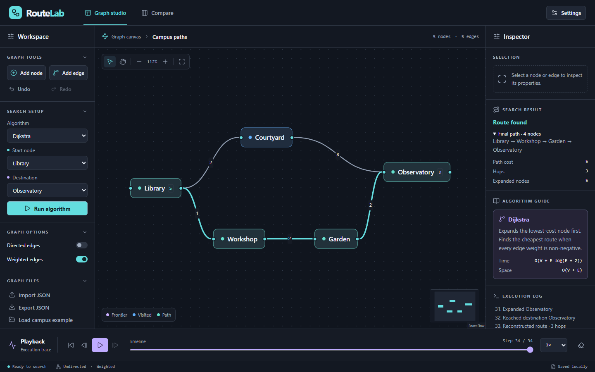
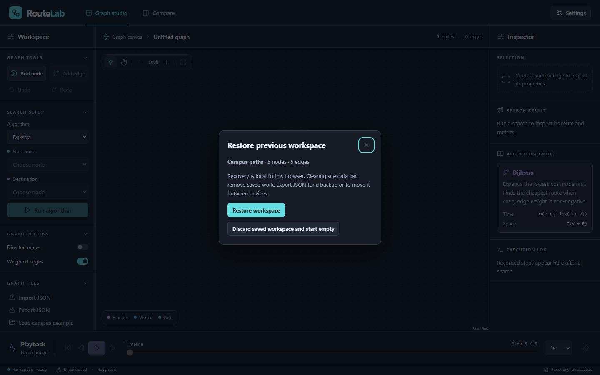

# RouteLab

RouteLab is an interactive graph-search studio built with React, TypeScript, and React Flow. Draw a graph, replay the decisions made by four search algorithms, and compare the routes they return. First-time visitors start with an empty workspace. Returning visitors can restore their last saved graph.



## Install and launch on Windows

Install Git for Windows using the installer for your processor. Install **Node.js 24 LTS** with npm. The project supports 24.16 or newer within 24.x. CI uses 24.22.2 from `.nvmrc`. For Intel or AMD 64-bit Windows, select the x64 Git installer and Node x64 MSI. [Git for Windows](https://git-scm.com/downloads/win) · [Node 24.22.2 downloads](https://nodejs.org/dist/v24.22.2/)

If Node is already installed, check `node --version` and `where.exe node` in PowerShell. Keep a supported 24.x installation. If another project needs a different major version, use your existing version manager to select 24.22.2, or extract the official Windows Node ZIP and prepend its extracted directory to the current shell's `$env:Path`. Open a new terminal after using an installer. While this repository remains private, cloning requires GitHub access; after publication, anyone can clone it.

```powershell
git --version
node --version
npm.cmd --version
git clone --branch main https://github.com/aadarsha-hiremath/routelab-dsa.git
cd routelab-dsa
npm.cmd ci
npm.cmd run dev
```

Open the Local URL printed by Vite, normally <http://localhost:5173>. Press Ctrl+C to stop. To serve the production bundle locally, run these commands in the checkout.

```powershell
npm.cmd run build
npm.cmd run preview
```

## Edit a graph

1. Choose **Add node**, or double-click empty canvas space. The first two new nodes fill the start and destination slots when those slots are empty. You can change either endpoint under **Search setup**, including using the same node for both.
2. Drag nodes to reposition them. Connect the right handle of one node to the left handle of another, or use **Add edge** and choose both endpoints. New weighted edges default to 1. Undirected edges can be traversed either way.
3. Select a node to edit its ID and coordinates in the inspector. **Apply node** updates incident edges and endpoint references together. Select an edge to edit its weight or delete it. Deleting a node removes its incident edges and clears affected endpoint selections.
4. Toggle directed or weighted edges under **Graph options**. A direction change that would introduce duplicates is rejected. Removing non-unit weights requires confirmation. Undo restores the previous weights.
5. Use the canvas toolbar to pan, zoom, or fit the graph. The minimap supports panning and zooming. Use the collapsible sidebar sections on desktop or **Tools** and **Inspector** on a narrow screen.
6. Choose **Load campus example** to replace the graph explicitly. **Undo** can restore edits, imports, sample loads, and workspace clears. History holds up to 50 edits with a size budget for larger graphs. **Export JSON** saves the current graph to a file.

## Run, play back and compare

Choose an algorithm and both endpoints, then select **Run algorithm**. Search and JSON import run in Web Workers. The inspector reports the complete final route, actual cost, edge count, and expansions. The canvas starts at step zero so you can replay the decisions that produced the result.

Use Play, Pause, Restart, single-step controls, or the timeline. Playback speed ranges from 0.5× to 8×. The execution log describes the current event and recent steps. Frontier, expanded nodes, examined edges, and reconstructed routes update at their recorded steps. The **S** and **D** badges identify endpoints. **Clear visualization** removes the recording while retaining the graph.

Recordings stop at 10,000 events. **Partial recording** identifies a recorded prefix. The result still covers the complete search. Editing the graph invalidates results, cancels obsolete work, and resets playback.

In **Compare**, choose **Compare all four**. Each row reports status, cost, hops, expanded nodes, and one elapsed search time on the same validated graph. Timings use the worker's monotonic clock and exclude parsing, worker startup, tracing, UI rendering, and playback. Sub-millisecond runs are sensitive to timer resolution and JIT warmup. Negative weights produce a per-algorithm error for Dijkstra and A*.

## Import and export

Choose **Import JSON** and select a UTF-8 file up to 2 MiB. An invalid import leaves your current graph intact. Export writes the complete editable document in the Phase 1 format, including coordinates, original edge order, and any configured endpoints. A sample is available in [examples/campus.json](examples/campus.json).

```json
{
  "directed": true,
  "weighted": true,
  "start": "A",
  "destination": "B",
  "nodes": [
    { "id": "A", "x": 0, "y": 0 },
    { "id": "B", "x": 220, "y": 0 }
  ],
  "edges": [{ "from": "A", "to": "B", "weight": 3 }]
}
```

Both flags and both arrays are required. IDs are unique, nonblank, case-sensitive strings. Coordinates and weights must be finite numbers. All edge references and supplied endpoints must exist. Imported endpoints are optional and can be set before searching. Self-loops and duplicate edges are rejected. Reverse arcs are distinct only in directed graphs. Unweighted documents omit edge weights. Additional fields are retained on import and export.

## Automatic saving and recovery

RouteLab saves the current document to IndexedDB after each committed edit, including a completed drag, import, undo or redo. **Saving** means a write is pending. **Saved locally** means it committed. The saved document includes its name, graph options, endpoints, coordinates, edge order, weights and additional JSON fields. Playback, results and undo history last for the current session.

On your next visit, **Restore previous workspace** offers to restore the graph or discard it and start empty. Escape or Close preserves the saved copy. Choose **Review saved workspace** to return to that decision. **Clear workspace** removes the recovery copy when the write completes. You can still undo a clear during that session.



Recovery is local to this browser profile and site address, including the port. It provides no cloud synchronization. Clearing site data, private browsing or browser eviction can remove a saved graph. **Export JSON** makes a portable backup. If a save fails, export your work before closing. Retry transient write failures. If another tab saved first, export the current tab's edits and reload to choose which document to continue. A damaged or unsupported saved copy requires explicit discard.

## Keyboard and preferences

| Action | Control |
| --- | --- |
| Move focus / activate a control | Tab, Shift+Tab / Enter or Space |
| Select a focused node or edge | Enter or Space |
| Remove the selected item | Delete outside text fields, menus and dialogs |
| Undo / redo a graph edit | Ctrl+Z / Ctrl+Shift+Z or Ctrl+Y; Command is supported on macOS |
| Toggle playback | Space with workspace focus |
| Scrub a focused timeline | Arrow keys, Home or End |
| Clear selection or dismiss a dialog | Escape |

**Settings** saves theme (dark, light, system), playback speed, reduced motion, grid, snapping, and minimap visibility in local storage independently of graph recovery. Dark is the initial theme. System follows OS changes. OS reduced-motion preferences also suppress transitions. **Reset preferences** restores defaults. If a preference write fails, the app reports that the change applies to the session.

## Search behavior

| Search | Frontier and order | Route guarantee |
| --- | --- | --- |
| BFS | FIFO array with a moving head. A node enters once. | Fewest edges. Total weight is reported separately. |
| DFS | Stack of adjacency iterators, implemented as indices. Continues the first available branch. | A reachable path. It can use more edges and have greater cost. |
| Dijkstra | Stable binary min-heap ordered by cumulative weight (g). | Minimum total weight on non-negative graphs. |
| A* | Same heap, ordered by g plus a heuristic (h). Improved scores can reopen nodes. | Minimum total weight when h is admissible, non-negative and zero at the goal. |

Adjacency lists follow input edge order. The heap breaks priority ties by insertion order. Equal-cost relaxations retain the first predecessor. Superseded heap entries are discarded before expansion. All searches stop on expanding the destination. Unreachable results have an empty path and null cost and hop count. Starting at the destination yields one expansion and zero cost.

A* defaults to h = 0, including in the browser. Engine callers can pass a deterministic function of the current node and destination. The engine checks finiteness, non-negativity, and zero at the goal. The caller must establish admissibility (h never exceeds the remaining minimum cost). An overestimate can produce a suboptimal route. The benchmark's Manhattan distance is admissible because each edge moves one grid unit and costs at least one. Arbitrary coordinates alone provide no such guarantee.

### Engine and execution events

```ts
import { parseGraph } from './src/engine/graph.ts'
import { search } from './src/engine/search.ts'

const graph = parseGraph(JSON.parse(jsonText))
const result = search(graph, 'dijkstra', {
  start: 'A', destination: 'B', traceLimit: 200
})
```

`parseGraph` validates unknown input and builds an immutable adjacency snapshot once. Reuse it across runs. `GraphDocument` describes the wire format for typed producers. Additional JSON fields are ignored. Costs use JavaScript numbers with ordinary floating-point rounding. Operations that overflow the finite range raise an error.

`visited` records expansion order including the goal. `expanded` counts expansion events, including repeat expansions if A* reopens a node. `path`, `hops`, `cost`, and `status` describe the actual result. All timing is external to search.

Trace recording defaults to off. A positive `traceLimit` captures a deterministic prefix of at most 10,000 events. `trace.truncated` flags discarded events once the limit is exceeded. The independent result remains complete. Disabling recording returns an empty trace with `truncated: false`.

| Event | Meaning |
| --- | --- |
| started / completed | Run endpoints and algorithm / terminal status. |
| discovered / frontier-added | First insertion of a node / each insertion, including improved weighted entries. |
| expanded | Search selected a current entry, including the destination. Stale entries are skipped. |
| edge-examined | A neighbor was inspected, even when already seen. |
| distance-updated | Initial g-score or a strictly improved g-score in a cost-based search. |
| destination-reached / path-reconstructed | Expansion of the goal / full route assembled in start-to-goal order. |

## Complexity

Let V be the number of nodes and E the number of adjacency entries (two per undirected edge). Graph construction uses expected O(V + E) time and space with hash maps and sets. Runs reuse the graph. Bounds below include the result and assume constant-time ID lookup and heuristic evaluation.

| Search | Worst-case time | Auxiliary and result space |
| --- | --- | --- |
| BFS / DFS | O(V + E) | O(V) |
| Dijkstra / A* with zero or consistent h | O(V + E log(E + 2)) | O(V + E) |
| A* with an inconsistent admissible h | O(V + S + P log(P + 1)) | O(V + P) |

S counts all adjacency entries scanned across expansions and P counts heap insertions including the start. Reopening can make these much larger than E. Lazy heap updates can retain old entries. A trace adds O(L) event records for configured limit L, with the reconstructed path shared with the result. With tracing disabled, no event history accumulates.

## Verification and benchmarks

Run from the checkout in PowerShell. Playwright uses installed system Chrome on standard Windows installations and its downloaded Chromium elsewhere.

```powershell
npm.cmd test
npm.cmd run typecheck
npm.cmd run build
npx.cmd playwright install chromium
npm.cmd run test:browser
npm.cmd run bench
npm.cmd run bench:studio
```

The engine suite includes a 20,000-node chain, equal-cost paths, A* reopening, and an independent Floyd–Warshall oracle. Studio tests cover editing transactions, undo/redo, bounded traces, comparison, preference decoding, and cancellation of obsolete worker replies. Production browser tests exercise pointer dragging and handle connections, keyboard deletion, playback, import/export, full browser restart persistence, mobile controls, and large-graph fallback. CI runs a clean install, Vitest, production build, and the Chromium browser suite.

The engine benchmark reports eleven timed runs after three warmups on open and weighted-barrier 100 × 100 grids. The studio benchmark measures edit, drag and scrub behavior on a 144-node grid, and import, save, playback, pan, zoom and renderer JS heap for a 250-node/500-edge graph and a dense 22-node/462-edge graph. Results depend on browser, hardware and workload. [Phase 3 measurements, release notes and review checklist](docs/release-readiness.md)

## Structure and practical limits

| Location | Responsibility |
| --- | --- |
| `src/engine/` | UI-independent graph validation, adjacency lists, four search algorithms, heap and event types |
| `src/app/editor.ts`, `Canvas.tsx` | Validated editing transactions, bounded history, controlled React Flow canvas |
| `src/app/recovery.ts`, `useRecovery.ts` | Versioned local documents, transaction ordering and recovery decisions |
| `src/app/protocol.ts`, `search.worker.ts` | Worker ownership, import, traced runs and comparison |
| `src/app/playback.ts`, `Panels.tsx`, `App.tsx` | Indexed event history, inspector, settings, timeline and workspace |
| `tests/`, `browser/`, `benchmarks/` | Engine and studio tests, production browser workflows and performance harnesses |

The interactive canvas supports up to 250 nodes and 500 edges. Larger imports enter overview mode with the complete data available for search, comparison and export. Endpoint entry uses exact IDs on large graphs. Coordinates use canvas units. Closely spaced imported nodes can overlap and can be repositioned through the inspector. Browser timings describe this device and workload. Graphs use JavaScript number precision.

## Troubleshooting

- **Windows reports EPERM, EBUSY or a locked native dependency during install.** Stop this checkout's dev server, preview, test watcher and browser tests with Ctrl+C in their terminals. Close tools still using its build files, reopen PowerShell in the checkout and run `npm.cmd ci` again. A fresh clone in a separate writable directory can verify whether the original directory is still locked.
- **PowerShell blocks an npm script or uses the wrong Node version.** Use `npm.cmd` and `npx.cmd`. Check `where.exe node`, select a supported Node 24.x installation and rerun `npm.cmd ci`.
- **A previous workspace appears missing.** Reopen the same site address and port in the same browser profile. Dev and production preview use different ports by default. Use a JSON backup when moving between them. Wait for **Saved locally** before closing.
- **A JSON file exceeds 2 MiB.** Export uses compact JSON when indentation would exceed the import limit. If the graph data itself exceeds the limit after edits, keep the full export and split or reduce a copy before importing.

## Version and release notes

The source package version is **0.3.0**. See the [v0.3.0 release notes](docs/RELEASE_NOTES_v0.3.0.md) for highlights, requirements, and limitations. Versioned GitHub tags and GitHub Releases are published separately; a repository commit is not itself a published GitHub Release.

[MIT License](LICENSE)
